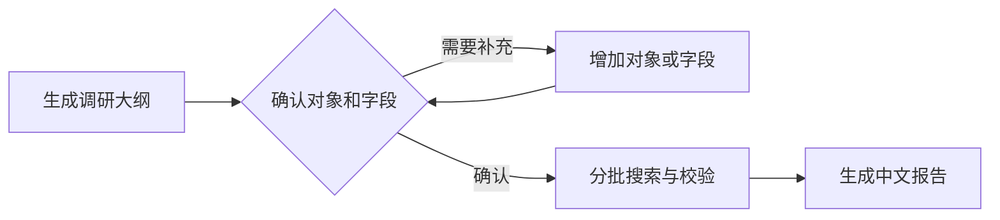

# 深度调研插件

适用于 Claude Code、OpenCode 和 Codex。先生成并确认调研大纲，再分批搜索、校验结果并汇总成中文报告。

## 使用场景

- **学术研究**：论文综述、基准评测、文献分析
- **技术研究**：技术对比、框架评估、工具选型
- **市场研究**：竞品分析、行业趋势、产品比较
- **尽职调查**：公司研究、投资分析、风险评估

## 安装

按所用工具执行安装命令。每个插件都包含五个中文调研技能、搜索策略和 JSON 校验脚本。

### Claude Code

```bash
claude plugin marketplace add liao666brant/Deep-Research-skills &&
claude plugin install deep-research@deep-research-skills
```

### Codex

```bash
codex plugin marketplace add liao666brant/Deep-Research-skills &&
codex plugin add deep-research@deep-research-skills
```

### OpenCode 2

```bash
opencode plugin add github:liao666brant/Deep-Research-skills
```

OpenCode 联网调研使用已连接的网页搜索提供商。若尚未配置，在 OpenCode 中连接一个提供商并允许网页搜索。

安装后打开新会话。运行深度调研前，请确认当前 Python 3 环境已安装 PyYAML。需要时在该环境中运行 `python3 -m pip install PyYAML`。

## 命令

在 Claude Code 中输入 `/deep-research:research`。在 Codex 中用 `/skills` 选择 `deep-research:research`。在 OpenCode 中输入 `@research`。

| 命令 | 用途 |
| --- | --- |
| `research` | 生成调研对象清单和字段定义 |
| `research-add-items` | 向现有大纲补充调研对象 |
| `research-add-fields` | 向现有大纲补充字段定义 |
| `research-deep` | 并行调研各对象并校验 JSON 结果 |
| `research-report` | 将 JSON 结果汇总为 Markdown 报告 |

## 工作流 & 示例

以「2025 年 AI Agent 演示」为例，调研各产品的发布时间、主要能力和使用条件。下面的示例可以直接发给 Claude Code、Codex 或 OpenCode。



### 1. 生成调研大纲

```text
用 research 技能为「2025 年 AI Agent 演示」生成调研大纲。重点比较发布日期、主要能力和使用条件。
```

确认调研范围、对象和字段后，你会得到 `outline.yaml` 和 `fields.yaml`。前者记录调研对象和执行配置，后者记录每个对象要查哪些信息。

### 按需补充调研对象或字段

如果清单里还缺产品，或者有新的问题要查，可以分别发送下面的指令。

```text
用 research-add-items 把 Claude Computer Use 加入调研清单。
用 research-add-fields 在「使用条件」下补充「何时需要人工介入」这个字段。
```

确认后，技能会分别更新 `outline.yaml` 或 `fields.yaml`。

### 2. 分批深度调研

```text
用 research-deep 按已确认的大纲开始调研。
```

技能会分批并行搜索，将每个对象的结果保存为 JSON，并按 `fields.yaml` 校验字段覆盖情况。暂时无法确认的值会标记为 `[不确定]`。每批结束后，由你决定是否继续。

### 3. 生成报告

```text
用 research-report 汇总调研结果。如果有发布日期，把它显示在报告目录里。
```

你会得到 `report.md`。目录可以显示选定的摘要字段，并跳转到每个对象的详情。报告会跳过标记为不确定的字段值。

## 来源和许可证

本仓库派生自 [Deep Research Skills](https://github.com/Weizhena/Deep-Research-skills)。项目灵感来自论文 [RhinoInsight: Improving Deep Research through Control Mechanisms for Model Behavior and Context](https://arxiv.org/abs/2511.18743)。

采用 [MIT 许可证](LICENSE)。
